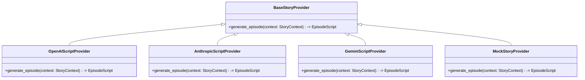

# AI Providers Architecture & Integration Guide

## 1. Provider Independence Philosophy

**Your Life, Your Series** utilizes a clean provider abstraction architecture. All generative features—story script generation, scene visuals, narration TTS, and speech-to-text—are hidden behind abstract interfaces (`BaseStoryProvider`, `BaseImageProvider`, `BaseTTSProvider`).

This design guarantees that:
- Changing from OpenAI to Anthropic, Gemini, Groq, or local models requires only changing an environment variable (`STORY_PROVIDER=gemini` or `STORY_PROVIDER=openai`).
- Development and automated unit/integration tests run reliably without paid API keys via high-fidelity, deterministic `MockStoryProvider`, `MockImageProvider`, and `MockTTSProvider`.
- Every provider adheres strictly to validated Pydantic models.



---

## 2. Supported Providers & Configuration

### 2.1. Story Generation (`STORY_PROVIDER`)
| Provider | Supported Models | Configuration Keys |
|---|---|---|
| `mock` (Default) | Deterministic scripted engine | None needed |
| `openai` | `gpt-4o`, `gpt-4o-mini` | `OPENAI_API_KEY` |
| `anthropic` | `claude-3-5-sonnet`, `claude-3-haiku` | `ANTHROPIC_API_KEY` |
| `gemini` | `gemini-1.5-pro`, `gemini-1.5-flash` | `GEMINI_API_KEY` |
| `groq` | `llama-3.1-70b-versatile` | `GROQ_API_KEY` |

### 2.2. Visual Artwork Generation (`IMAGE_PROVIDER`)
| Provider | Target Format | Configuration Keys |
|---|---|---|
| `mock` (Default) | Cinematic canvas generation with SVG/Pillow gradient renders | None needed |
| `openai` | DALL-E 3 (1792x1024 landscape) | `OPENAI_API_KEY` |
| `stability` | Stable Diffusion XL | `STABILITY_API_KEY` |
| `replicate` | Flux.1 Schnell / Dev | `REPLICATE_API_TOKEN` |

### 2.3. Audio & Voice Narration (`TTS_PROVIDER`)
| Provider | Supported Voices | Configuration Keys |
|---|---|---|
| `mock` (Default) | Built-in audio tone generator with realistic scene pacing | None needed |
| `openai` | `alloy`, `echo`, `fable`, `onyx`, `nova`, `shimmer` | `OPENAI_API_KEY` |
| `elevenlabs` | Custom voice IDs, expressive prosody | `ELEVENLABS_API_KEY`, `ELEVENLABS_VOICE_ID` |

---

## 3. Narrative Continuity Engine

The Story Engine receives a structured `StoryContext` object containing:
- **Character**: Archetype, core traits, visual anchors.
- **Productivity Outcomes**:
  - `completed_tasks`: Tasks checked off today. Converted into character breakthroughs, new business partnerships, or romantic sparks.
  - `missed_tasks`: Tasks left incomplete. Converted into comedic hurdles, cliffhangers, or minor plot challenges—**never humiliation or shame**.
- **Continuity State**:
  - Season & episode number.
  - Unresolved plot hooks (e.g., "The mysterious venture capitalist requested a meeting at 9 AM").
  - Current allies and rivals.
- **Genre Constraints**: Romantic Comedy, Sci-Fi, Thriller, Fantasy, Anime Adventure, Slice of Life.

### Validated Episode Schema
All models produce output validated against:
```json
{
  "episode_title": "The Midnight Pivot",
  "opening_hook": "When the investor deck vanishes at 2 AM, Cary's night takes an unexpected turn...",
  "scenes": [
    {
      "scene_number": 1,
      "title": "The High-Stakes Boardroom",
      "visual_description": "Cary standing in a sleek high-rise boardroom overlooking city lights",
      "image_prompt": "Cinematic 16:9 photo of a confident young female CEO in navy suit, modern glass boardroom, neon city glow outside, dramatic lighting",
      "narration": "They said a seed round was impossible in this market. Cary didn't agree.",
      "dialogue": [
        {"speaker": "Cary", "line": "Check the numbers again. We just closed our third enterprise client."}
      ],
      "mood": "tense_triumphant",
      "duration_seconds": 15
    }
  ],
  "cliffhanger": "Her phone rings with an unknown European country code...",
  "summary": "Cary defended her enterprise metrics but skipped her workout, leading to a late-night scramble.",
  "narrative_updates": {
    "new_allies": ["Marcus Vance"],
    "unresolved_threads": ["Mystery caller from Zurich"]
  }
}
```
