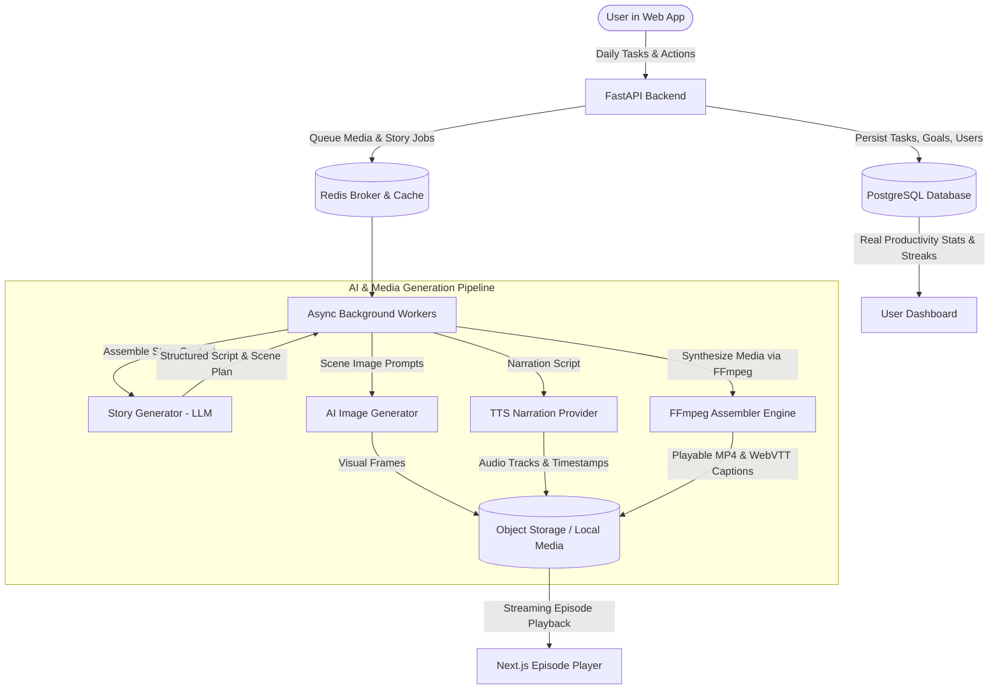

# System Architecture: Your Life, Your Series

## 1. Executive Summary & Vision

**Your Life, Your Series** is an AI-powered episodic productivity companion that transforms real-world goals, daily tasks, achievements, and setbacks into a personalized streaming series. The user's digital alter-ego navigates an ongoing storyline reflecting their real-world ambitions and daily task outcomes.

The platform bridges three critical pillars:
1. **Real-Life Productivity Engine**: Hierarchical goals, milestones, daily task tracking, recurring tasks, streaks, and experience points (XP).
2. **Personalized Narrative Engine**: Continuity state machines, character profiles, genre archetypes, and structured scene generation reflecting actual task completion and setbacks.
3. **Multimedia Pipeline**: Automated generation of scene artwork, text-to-speech audio narration, synchronized captions, background score mixing, and FFmpeg video assembly into streaming-ready MP4 episodes.

---

## 2. Component Architecture

### 2.1. Frontend (`apps/web`)
- **Framework**: Next.js 15+ (App Router), React 19, TypeScript with strict typing.
- **Styling & UI**: Tailwind CSS, custom design tokens based on the Cosmic Indigo palette (`#2B2D42`), Velvet Plum (`#6B3B7A`), Aurora Coral (`#FF6B6B`), Solar Amber (`#FFB347`), and Neo Mint (`#A8E6CF`).
- **Icons & Visuals**: Lucide React icons, rich micro-animations, glassmorphism cards.
- **State & Query**: TanStack Query / React hooks for data fetching, caching, optimistic mutations with safe server reconciliation.
- **Form Management**: React Hook Form with Zod schemas matching backend validation.
- **Streaming Media Player**: Custom HTML5 / video player supporting MP4, captions (VTT), seek controls, full screen, keyboard accessibility.

### 2.2. Backend API (`services/api`)
- **Framework**: FastAPI (Python 3.11+), Uvicorn ASGI server.
- **Data Persistence**: SQLAlchemy 2.0 (async + sync support) with PostgreSQL 17/18, Alembic migrations.
- **Security & Auth**: OAuth2 Password bearer flow, bcrypt password hashing, secure JWT access tokens, HttpOnly refresh cookies, CSRF protection, role & ownership verification on every endpoint.
- **Service Layer**: Decoupled domain services (`TaskService`, `GoalService`, `GamificationService`, `StoryService`, `MediaService`, `BillingService`).
- **Provider Adapters**: Extensible abstract interfaces for LLMs, image generation, text-to-speech, and object storage.

### 2.3. Background Workers & Media Pipeline
- **Job Coordination**: Redis queue with Celery/Redis background worker runner.
- **State Machine**: Explicit granular job states (`queued` -> `script_generating` -> `image_generating` -> `audio_generating` -> `video_assembling` -> `completed` / `failed`).
- **Assembly Engine**: FFmpeg and FFprobe for image pan/zoom (Ken Burns effect), narration mixing, background music ducking, and MP4 encoding.

---

## 3. Data Flow: Episode Generation

1. **Trigger**: User completes their day's tasks and clicks **"Generate My Episode"**.
2. **Context Compilation**: Backend collects:
   - User character archetype and long-term goal.
   - Selected genre (Romantic Comedy, Thriller, Slice of Life, Anime Adventure, Sci-Fi, Fantasy).
   - Completed vs. missed tasks with timestamps and priorities.
   - Prior episode summaries and active narrative state (rivals, allies, unresolved plot threads).
3. **Structured Script Generation**: LLM receives structured schema and returns:
   - Episode title, opening hook, 3-5 structured scenes with visual descriptions, dialogue, narration, mood, and estimated duration.
   - Continuity updates and narrative cliffhanger.
4. **Media Synthesis**:
   - Background worker processes scene image prompts.
   - TTS synthesizes voice narration per scene.
   - FFmpeg compiles images, audio, captions, and background music into a 720p/1080p MP4.
5. **Validation & Storage**: File verified with FFprobe, stored with metadata, and flagged `completed` in PostgreSQL.
6. **Playback**: User receives in-app notification and streams episode on the episode detail page.
