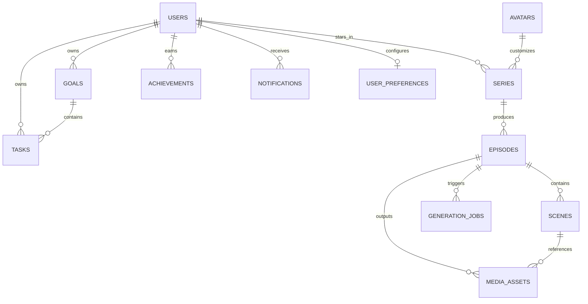

# Database Architecture & Schema Specification

## 1. Relational Database Design

The primary datastore for **Your Life, Your Series** is PostgreSQL.
All relational business data—including users, authentication records, tasks, goals, narrative states, episodes, scenes, media assets, generation jobs, achievements, and notifications—is persisted in PostgreSQL.

## 2. Entity Relationship Model

---

## 3. Schema Definitions

### 3.1. `users`
- `id`: UUID (Primary Key)
- `email`: VARCHAR(255) (Unique, Indexed)
- `hashed_password`: VARCHAR(255) (Bcrypt hash)
- `display_name`: VARCHAR(100) (Not Null)
- `is_active`: BOOLEAN (Default: True)
- `is_verified`: BOOLEAN (Default: False)
- `level`: INTEGER (Default: 1)
- `xp`: INTEGER (Default: 0)
- `current_streak`: INTEGER (Default: 0)
- `longest_streak`: INTEGER (Default: 0)
- `created_at`: TIMESTAMPTZ (Default: NOW())
- `updated_at`: TIMESTAMPTZ (Default: NOW())

### 3.2. `user_preferences`
- `id`: UUID (Primary Key)
- `user_id`: UUID (Foreign Key -> `users.id`, Unique)
- `time_zone`: VARCHAR(50) (Default: 'UTC')
- `language`: VARCHAR(10) (Default: 'en')
- `email_notifications`: BOOLEAN (Default: True)
- `daily_reminder_time`: TIME (Default: '20:00')
- `preferred_tone`: VARCHAR(50) (Default: 'motivational')
- `caption_enabled`: BOOLEAN (Default: True)
- `background_music_enabled`: BOOLEAN (Default: True)
- `music_volume`: FLOAT (Default: 0.25)

### 3.3. `avatars`
- `id`: UUID (Primary Key)
- `name`: VARCHAR(100) (Not Null)
- `archetype`: VARCHAR(50) (CEO, Artist, Athlete, Student, Scholar, Inventor)
- `description`: TEXT
- `personality_traits`: JSONB (e.g. `["ambitious", "witty", "resilient"]`)
- `visual_prompt_attributes`: TEXT (e.g. `sharp navy suit, dark wavy hair, confident stance`)
- `image_url`: VARCHAR(500)
- `is_template`: BOOLEAN (Default: True)
- `created_at`: TIMESTAMPTZ

### 3.4. `goals`
- `id`: UUID (Primary Key)
- `user_id`: UUID (Foreign Key -> `users.id`, Indexed)
- `title`: VARCHAR(255) (Not Null)
- `description`: TEXT
- `category`: VARCHAR(50) (Career, Fitness, Education, Startup, Creative, Personal)
- `target_date`: DATE
- `is_completed`: BOOLEAN (Default: False)
- `progress_percentage`: FLOAT (Default: 0.0)
- `created_at`: TIMESTAMPTZ
- `updated_at`: TIMESTAMPTZ

### 3.5. `tasks`
- `id`: UUID (Primary Key)
- `user_id`: UUID (Foreign Key -> `users.id`, Indexed)
- `goal_id`: UUID (Foreign Key -> `goals.id`, Nullable, Indexed)
- `title`: VARCHAR(255) (Not Null)
- `description`: TEXT
- `priority`: VARCHAR(20) (low, medium, high, urgent)
- `status`: VARCHAR(20) (pending, in_progress, completed, missed, archived)
- `due_date`: TIMESTAMPTZ (Indexed)
- `completed_at`: TIMESTAMPTZ (Nullable)
- `xp_reward`: INTEGER (Default: 50)
- `is_recurring`: BOOLEAN (Default: False)
- `recurrence_rule`: VARCHAR(100) (e.g. 'FREQ=DAILY', 'FREQ=WEEKLY')
- `created_at`: TIMESTAMPTZ
- `updated_at`: TIMESTAMPTZ

### 3.6. `series`
- `id`: UUID (Primary Key)
- `user_id`: UUID (Foreign Key -> `users.id`, Indexed)
- `avatar_id`: UUID (Foreign Key -> `avatars.id`)
- `title`: VARCHAR(255) (Not Null)
- `genre`: VARCHAR(50) (romantic_comedy, thriller, slice_of_life, anime_adventure, scifi, fantasy, historical)
- `current_season`: INTEGER (Default: 1)
- `current_episode_number`: INTEGER (Default: 0)
- `narrative_state`: JSONB (Active allies, rivals, ongoing conflicts, unresolved plot hooks)
- `status`: VARCHAR(20) (active, completed, paused)
- `created_at`: TIMESTAMPTZ
- `updated_at`: TIMESTAMPTZ

### 3.7. `episodes`
- `id`: UUID (Primary Key)
- `series_id`: UUID (Foreign Key -> `series.id`, Indexed)
- `user_id`: UUID (Foreign Key -> `users.id`, Indexed)
- `episode_number`: INTEGER (Not Null)
- `title`: VARCHAR(255) (Not Null)
- `summary`: TEXT
- `opening_hook`: TEXT
- `cliffhanger`: TEXT
- `script_json`: JSONB (Complete structured scene definitions, dialogues, narrations)
- `task_snapshot`: JSONB (List of completed and missed tasks that formed this episode)
- `generation_status`: VARCHAR(30) (queued, script_generating, image_generating, audio_generating, video_assembling, completed, failed)
- `video_url`: VARCHAR(500) (Nullable)
- `duration_seconds`: FLOAT (Default: 0.0)
- `view_count`: INTEGER (Default: 0)
- `created_at`: TIMESTAMPTZ (Default: NOW())

### 3.8. `scenes`
- `id`: UUID (Primary Key)
- `episode_id`: UUID (Foreign Key -> `episodes.id`, Indexed)
- `scene_number`: INTEGER (Not Null)
- `title`: VARCHAR(255)
- `visual_description`: TEXT
- `image_prompt`: TEXT
- `narration_text`: TEXT
- `dialogue`: JSONB (List of speaker-line objects)
- `mood`: VARCHAR(50)
- `duration_seconds`: FLOAT (Default: 15.0)
- `image_url`: VARCHAR(500) (Nullable)
- `audio_url`: VARCHAR(500) (Nullable)
- `created_at`: TIMESTAMPTZ

### 3.9. `generation_jobs`
- `id`: UUID (Primary Key)
- `user_id`: UUID (Foreign Key -> `users.id`, Indexed)
- `episode_id`: UUID (Foreign Key -> `episodes.id`, Indexed)
- `job_type`: VARCHAR(50) (episode_full, scene_image, scene_tts, video_assembly)
- `status`: VARCHAR(30) (queued, processing, completed, failed, cancelled)
- `progress_percent`: INTEGER (Default: 0)
- `current_stage`: VARCHAR(100)
- `error_message`: TEXT (Nullable)
- `retry_count`: INTEGER (Default: 0)
- `idempotency_key`: VARCHAR(255) (Unique, Indexed)
- `created_at`: TIMESTAMPTZ (Default: NOW())
- `updated_at`: TIMESTAMPTZ (Default: NOW())

### 3.10. `achievements` & `user_achievements`
- `id`: UUID (Primary Key)
- `slug`: VARCHAR(100) (Unique)
- `title`: VARCHAR(100)
- `description`: TEXT
- `badge_icon`: VARCHAR(100)
- `category`: VARCHAR(50)
- `xp_bonus`: INTEGER (Default: 100)

---

## 4. Database Migrations

Database migrations are powered by **Alembic**.
- Migration configuration: `services/api/alembic.ini`
- Migration versions directory: `services/api/migrations/versions/`
- Upgrading to head: `alembic upgrade head`
- Downgrading: `alembic downgrade -1`
