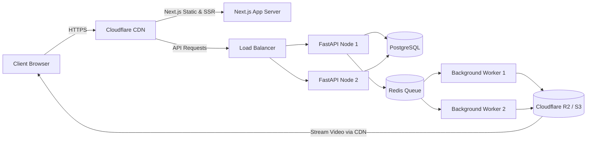

# Production Deployment & Infrastructure Guide

## 1. Deployment Topology

The recommended production deployment follows modern cloud best practices:

- **Frontend**: Next.js App Router deployed on Vercel, AWS Amplify, or a standalone Node.js container behind a CDN (Cloudflare).
- **Backend API**: FastAPI running via Uvicorn workers on AWS ECS / Render / Fly.io / GCP Cloud Run.
- **Background Workers**: Python Celery / Redis worker service deployed as a scalable background container.
- **Relational Database**: Managed PostgreSQL (AWS RDS / Supabase / Neon / Render PostgreSQL) with connection pooling.
- **Queue & Cache**: Managed Redis (AWS ElastiCache / Upstash / Redis Cloud).
- **Media Object Storage**: AWS S3 or Cloudflare R2 with CDN distribution and signed URLs.



---

## 2. Docker Compose Local Deployment

For unified local or staging deployment, a complete `docker-compose.yml` is provided at the root:

```bash
# Build and run all services
docker compose up --build -d

# Run migrations
docker compose exec api alembic upgrade head

# Seed initial avatar templates and test data
docker compose exec api python -m app.scripts.seed
```

---

## 3. Environment Variables & Secrets Checklist

Ensure the following secrets are configured in production:
- `SECRET_KEY`: High-entropy 64-character secret.
- `DATABASE_URL`: Connection string with SSL enabled (`sslmode=require`).
- `REDIS_URL`: Connection string with TLS (`rediss://...`).
- `STORAGE_BACKEND`: `s3` or `r2`.
- `AWS_ACCESS_KEY_ID`, `AWS_SECRET_ACCESS_KEY`, `S3_BUCKET_NAME`.
- AI provider keys: `OPENAI_API_KEY`, `ANTHROPIC_API_KEY`, or `GEMINI_API_KEY`.
- Payment provider: `STRIPE_SECRET_KEY`, `STRIPE_WEBHOOK_SECRET`.
